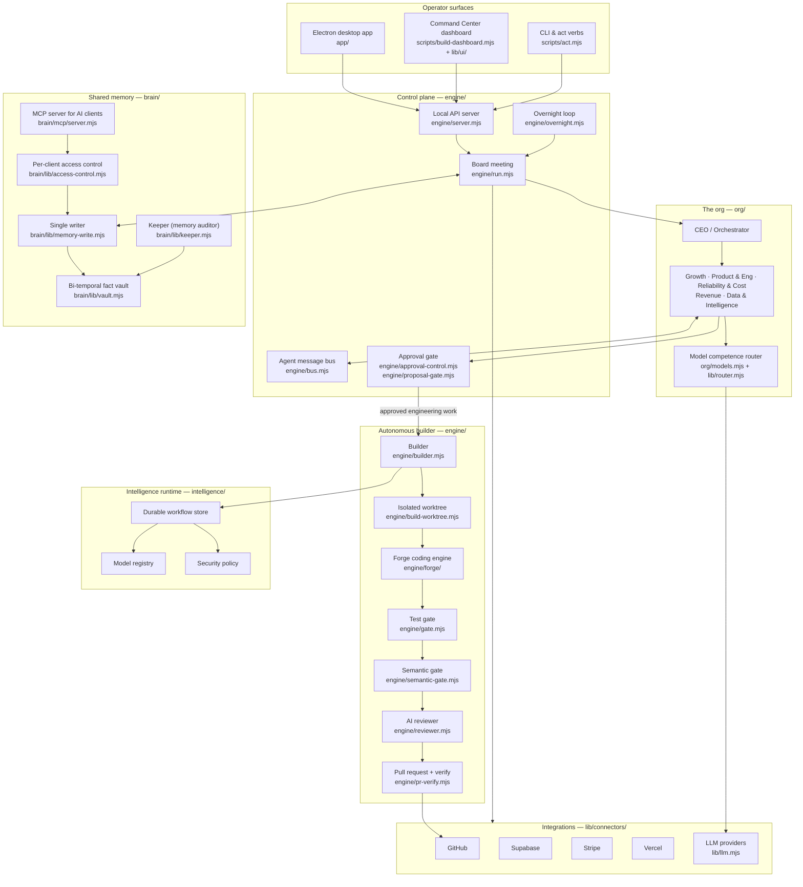

# Seen Command — an Agentic Executive Operating System

Seen Command is a local-first, multi-agent system that runs a startup's daily operations like a
company's leadership team. A **CEO / Orchestrator agent** holds a "board meeting" over live company
data, assigns the day's work to **five department agents**, and puts every outbound or code-changing
action through a **human approval gate**. Approved engineering work goes to an **autonomous builder**
that writes the code in an isolated git worktree, runs it through layered verification (tests, a
semantic "did it actually do the work" check, an AI code review, security policy), and opens a pull request.

Everything the system learns goes into a **shared bi-temporal memory ("the Brain")** that every agent,
the desktop app, and outside AI clients (through an MCP server) read and write.

> This is a public snapshot of a private, actively developed codebase. Credentials, infrastructure IDs,
> business data and personal information have been removed. The architecture and code are the same.

- **Pure Node.js, zero runtime npm dependencies:** only `node:` built-ins. Electron is used only to package the desktop app.
- **~66k lines of JavaScript, 150+ test files:** `node --test`, run in CI on every push.
- **Local-first AI:** a competence router assigns each task to the best available model: local Ollama models first, then hosted free tiers, with a frontier model as a last resort.

---

## Design principles

A few ideas shape every part of Seen Command. They came out of running a real company with it every day.

- **The org is data.** Departments, roles, charters and KPIs live in one file (`org/org.mjs`). To restructure the team, you edit data, not code.
- **Agents propose, people decide.** Anything outbound or production-affecting waits for a recorded human yes. Approvals are the main way the operator steers the team.
- **Nothing is called done until it's proven.** Builds pass tests, a semantic check and an independent review before they count. `org/capabilities.mjs` lists exactly what each agent can do today.
- **Memory keeps its history.** Facts are superseded, never overwritten, so the system can always answer what it knew and when.
- **A failure becomes new work.** A failed task turns into a tracked ticket with evidence, not a silent stop.
- **Every action is visible and scriptable.** Each meeting, approval and build adds a line to an activity ledger, and every button in the app is also a CLI verb, so people, scripts and AI agents all work the app the same way.

---

## Architecture at a glance



---

## Repository map

| Path | Layer | What it does |
|---|---|---|
| `app/` | Desktop shell | Electron main process, child-runtime supervisor, environment merging, launch policy, splash screen. |
| `engine/` | Control plane | The core runtime: board meeting, local HTTP API, approval gate, agent bus, autonomous builder, reviewer, gates, overnight loop, self-update, PR rescue. |
| `engine/forge/` | Coding engine | In-house coding engine: deterministic repo map → small verifiable step plan → best-of-N implementation → layered verifier → lessons memory. |
| `engine/evals/` | Evaluation | A sharded eval harness that scores the agents and builder against fixed cases. |
| `org/` | The org chart | Agent charters, department structure, the capability registry (what each agent can do), daily focus selection, and model assignment. |
| `intelligence/` | Intelligence runtime | Durable, inspectable workflow records for coding work: model registry, contracts, orchestrator state machine, runtime status, security policy. |
| `brain/` | Shared memory | Bi-temporal fact vault (valid-time + transaction-time, "supersede, never overwrite"), one shared writer, MCP server, access control, provenance, cloud mirror, memory-graph layout. |
| `lib/` | Shared services | LLM adapter + competence router, connectors, Brain API routes, tickets, notifications, failure loop, data-health and schema-drift checks, PR merge policy. |
| `lib/connectors/` | Integrations | GitHub, Supabase, Stripe, Vercel and product admin-stats readers. Each one is optional and degrades cleanly if not configured. |
| `lib/aggregation/` | Data pipelines | Scheduled collectors, probes and a dashboard for the product's data pipelines. |
| `lib/growth/` | Growth studio | Brand system, content calendar, positioning and the growth-meeting workflow. |
| `lib/money/` | Finance model | Unit economics, ledger, allocation and scale modelling (no real figures included). |
| `lib/instagram/` | Research pipeline | Job queue and insight extraction around the vendored video-to-knowledge compiler. |
| `lib/ui/` | Front end | Dependency-free browser clients for the app tabs: Command Center, Brain graph, Growth, Money. |
| `scripts/` | Operations CLI | Dashboard builder, `act` verbs (every UI action is also a CLI command), model discovery and benchmarking, drift checks, packaging, scheduling. |
| `skills/` | Agent playbooks | Markdown playbooks agents follow for recurring work (weekly review, data health, growth week…). |
| `tools/video-software-compiler/` | Python tool | A vendored, tested Python package that turns video content into structured knowledge. |
| `config/` | Configuration | Example configs for models, permissions and the app. |
| `deploy/` | Scheduling | launchd template for the scheduled overnight run. |
| `docs/` | Design docs | Architecture, memory model, security model, model strategy, intelligence runtime spec. |
| `.github/workflows/` | CI | Runs the full test suite on every push, with a per-file timeout so a hung test can't stall CI. |

---

## How a board meeting works (`engine/run.mjs`)

1. **Gather context.** Live business metrics come from the connectors, open work from GitHub, and
   current facts from the Brain (`lib/context-gather.mjs`, `lib/brain.mjs`).
2. **Pick the focus.** The CEO agent picks the biggest constraint of the day (`org/focus.mjs`) and builds the agenda.
3. **Allocate.** Each work item is routed to the right department and specialist agent (`org/org.mjs`).
4. **Draft proposals.** Each agent reasons on the model the competence router picked for that kind of work
   (`lib/router.mjs`, `lib/llm.mjs`). Agents can talk to each other on the bus (`engine/bus.mjs`).
5. **Gate.** Anything outbound or mutating goes to the **approvals queue** for a human yes/no
   (`engine/proposal-gate.mjs`, `engine/approval-control.mjs`).
6. **Remember.** Outcomes, decisions and new facts are written back to the Brain as bi-temporal facts.
7. **Debrief.** The dashboard shows the morning debrief, KPIs, per-department reports and pending approvals.

## How the autonomous builder ships code (`engine/builder.mjs`)

```
approved task
  → screen the task (rejects tasks built on something that doesn't exist, and closed issues)   engine/task-premise.mjs
  → split / contract the task                                engine/task-split.mjs, task-contract.mjs
  → baseline gate (target must already be green)            engine/gate.mjs
  → isolated git worktree                                   engine/build-worktree.mjs
  → implement (Forge, or an external coding agent)          engine/forge/, engine/agentic-coder.mjs
  → lint + test gate                                        engine/lint.mjs, engine/gate.mjs
  → semantic gate: empty files, stubs, undefined symbols    engine/semantic-gate.mjs
  → wiring / route / schema reference checks                engine/wiring.mjs, route-refs.mjs, schema-refs.mjs
  → AI diff review                                          engine/reviewer.mjs
  → open PR, verify CI, rescue or flag                      engine/pr-verify.mjs, pr-rescue.mjs, pr-flags.mjs
  → record outcome in the Brain + activity ledger
```

Failures never just stop the run. `lib/failure-loop.mjs` turns every failed build into a tracked
ticket with evidence, so the failure becomes new work.

## The Brain: shared bi-temporal memory (`brain/`)

- Every fact has **valid time** (when it was true in the world) and **transaction time** (when the system
  recorded it). Changing a fact **supersedes** it and keeps the old version, so the system can answer
  "what did we believe on date X?"
- **One write path** (`brain/lib/memory-write.mjs`) with file locking and provenance on every fact.
- **MCP server** (`brain/mcp/server.mjs`) gives outside AI clients tools to read, search, add,
  supersede and log decisions. Each client gets its own scoped, audited credential (`brain/lib/access-control.mjs`).
- A **Keeper** agent (`brain/lib/keeper.mjs`) audits the vault for duplicates, contradictions and stale facts.

## Safety model

- A human approves every outbound or production-affecting action. Product-repo changes are **PR-only**.
- Protected paths, credential-literal detection and secret redaction in logs and tickets
  (`engine/policy.mjs`, `engine/lint.mjs`, `brain/lib/tickets.mjs`).
- The local API only accepts requests from the local machine. Credentials are read from the
  environment and never written to the repo.
- See `docs/seen-command/SECURITY_MODEL.md`.

---

## Running it

```bash
npm run brief        # run a board meeting and build the dashboard
npm run serve        # serve the live app at http://localhost:4173
npm run app:dev      # open the Electron desktop app (needs `npm install` for Electron)
```

Configuration is all optional. Copy `.env.example` to `.env` and fill in only the connectors you want.
Anything missing shows as "not connected" and the app keeps running.

## Testing

```bash
find . -name '*.test.mjs' -not -path '*/node_modules/*' -print0 | xargs -0 node --test
```

## Tech stack

Node.js 22 (ES modules, `node:test`, `node:http`) · Electron · Model Context Protocol · Ollama and hosted
LLM APIs · GitHub / Supabase / Stripe / Vercel APIs · Python 3 (video compiler tool) · GitHub Actions
